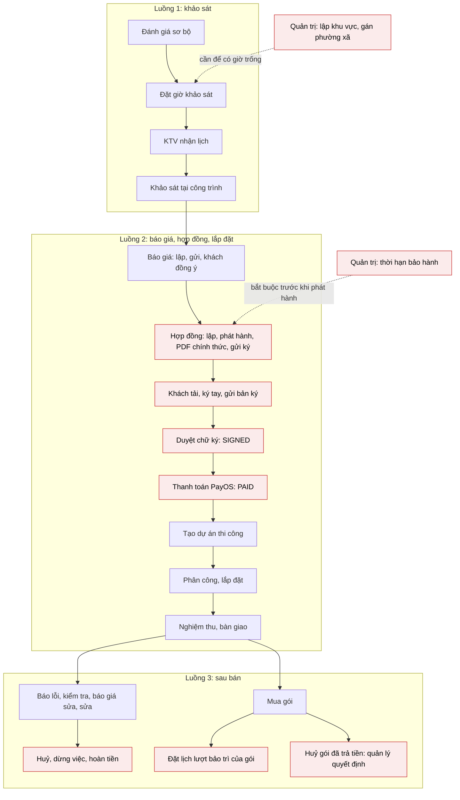

# Báo cáo API chưa tích hợp – Smart Solar Web Portal

Ngày lập: 03/11/2026. Đối chiếu trên image `smartsolar-api` build 21/10/2026 (`c43e1cada345`).

API đang chạy có **262 endpoint**; web portal gọi **185 (70,6 %)**, còn **77 chưa gọi**: 76 cần hàm service và màn hình,
1 là webhook PayOS chỉ backend nhận. Chỗ hổng nặng nhất là **luồng 2 đứt ngay sau báo giá**: hợp đồng và thanh toán hợp
đồng chưa có màn nào (15 endpoint), nên khách đồng ý báo giá xong không đi tiếp được trên web và dữ liệu test hợp đồng
hiện phải ghi tay vào DB. Danh sách để đánh dấu từng mục: [api-checklist.md](api-checklist.md).

## 1. Tóm tắt

| Chỉ số                                                      | Giá trị                                            |
| ----------------------------------------------------------- | -------------------------------------------------- |
| Endpoint trong swagger của API đang chạy                    | 262                                                |
| FE đã có lời gọi                                            | 185 (70,6 %)                                       |
| FE chưa gọi                                                 | 77 (76 việc của FE + 1 webhook)                    |
| Nhóm API (tag swagger)                                      | 44: 22 nhóm đã gọi đủ, 22 nhóm còn thiếu           |
| Nhóm chưa gọi endpoint nào                                  | 9 nhóm, 30 endpoint (kể cả webhook)                |
| FE đang gọi nhưng image 21/10 không có                      | 5 endpoint (mục 11)                                |
| Endpoint đã khai trong `endpoints.ts` nhưng chưa có service | 2 (`rag-configuration/draft/validate`, `rollback`) |

Ba phát hiện chính:

1. **Hợp đồng chặn cả luồng 2.** Kinh doanh 0/9 endpoint hợp đồng, khách 1/3, thanh toán hợp đồng 0/4. Dự án thi công chỉ
   tạo được khi hợp đồng `PAID`, nên màn "Thi công" của quản lý hiện chỉ chạy được với hợp đồng ghi tay vào DB.
2. **Một chặn ngầm ở quản trị.** Backend không cho phát hành hợp đồng khi chưa có thời hạn bảo hành lắp đặt
   (`400 CONTRACT_WARRANTY_REQUIRED`). Thời hạn này do admin cấu hình qua `warranty-options`, FE chưa có màn. Phải làm
   trước màn hợp đồng.
3. **Có yêu cầu khách tạo được mà không ai xử lý được trên web.** Khách đã gửi được yêu cầu huỷ gói đã trả tiền
   (`CANCELLATION_REQUESTED`), nhưng quyết định huỷ, danh sách hoàn tiền, duyệt và ghi nhận hoàn tiền (4 endpoint) chưa có
   màn.

## 2. Bối cảnh: vì sao số liệu đo trên image 21/10

Ngày 03/11 image `latest` mới (build 31/10) chặn mọi request bằng `SCHEMA_NOT_READY`: DB Supabase dùng chung còn thiếu 7
migration.

| Migration chờ chạy                                 |
| -------------------------------------------------- |
| `20261021164225_AddCommuneReferencePoints`         |
| `20261030122441_AutomatedInstallationQuotation`    |
| `20261030201506_SalesTerminalStates`               |
| `20261030201618_KnowledgeDocumentAudience`         |
| `20261030201748_InstallationEquipmentSubstitution` |
| `20261030201824_ManufacturerWarrantyCoverage`      |
| `20261031043834_ContractDraftDiscard`              |

Máy dev đã quay về image trước đó (`c43e1cada345`, build 21/10 20:22, khớp schema hiện tại); image 31/10 vẫn giữ trong
máy dưới tag `hoaikhoitran/smartsolar-api:2026-10-31`. Hệ quả cho báo cáo này:

- Image 31/10 có thể có thêm endpoint (tên migration gợi ý: báo giá lắp đặt tự động, thay thiết bị, bảo hành của hãng,
  huỷ bản nháp hợp đồng). Swagger của nó chưa đọc được nên chưa đối chiếu.
- 5 lời gọi FE viết theo backend mới hơn đang lỗi trên image 21/10 (mục 11).
- Khi người phụ trách backend chạy migration lên DB chung, cần chạy lại phép đối chiếu (mục 14).

## 3. Độ phủ theo nhóm API

22 nhóm còn thiếu, xếp theo số endpoint chưa gọi:

| Nhóm (tag swagger)      | Cổng chính          | Tổng | Đã gọi | Chưa gọi | Đã gọi (%) |
| ----------------------- | ------------------- | ---: | -----: | -------: | ---------: |
| ManagerAfterSales       | Quản lý, quản trị   |   17 |      7 |       10 |         41 |
| AdminKnowledgeDocuments | Quản trị            |   10 |      0 |       10 |          0 |
| SalesContracts          | Kinh doanh          |    9 |      0 |        9 |          0 |
| AdminOperationalZones   | Quản trị            |    7 |      1 |        6 |         14 |
| CustomerAfterSales      | Khách hàng          |   22 |     17 |        5 |         77 |
| AdminProducts           | Quản trị            |    9 |      4 |        5 |         44 |
| AdminAfterSales         | Quản trị            |    8 |      3 |        5 |         38 |
| AdminRagConfiguration   | Quản trị            |    9 |      5 |        4 |         56 |
| TechnicianAfterSales    | Kỹ thuật viên       |   12 |      9 |        3 |         75 |
| Chat                    | Mọi vai trò         |    3 |      0 |        3 |          0 |
| CustomerPayments        | Khách hàng          |    3 |      0 |        3 |          0 |
| SalesAfterSales         | Kinh doanh          |    8 |      6 |        2 |         75 |
| AdministrativeUnits     | Công khai           |    3 |      1 |        2 |         33 |
| CustomerContracts       | Khách hàng          |    3 |      1 |        2 |         33 |
| SalesQuotations         | Kinh doanh          |   10 |      9 |        1 |         90 |
| TechnicianOnSiteSurvey  | Kỹ thuật viên       |    8 |      7 |        1 |         88 |
| TechnicianAppointments  | Kỹ thuật viên       |    7 |      6 |        1 |         86 |
| AdminSurveyAppointments | Quản trị, quản lý   |    1 |      0 |        1 |          0 |
| AdminSurveyRequests     | Quản trị, quản lý   |    1 |      0 |        1 |          0 |
| CustomerSiteLocation    | Khách hàng          |    1 |      0 |        1 |          0 |
| StaffPayments           | Kinh doanh, quản lý |    1 |      0 |        1 |          0 |
| PayOsWebhook            | (PayOS gọi)         |    1 |      0 |        1 |          0 |

22 nhóm đã gọi đủ (109 endpoint): ManagerInstallations (12), TechnicianInstallations (10), Auth (9), AdminDispatchRequests,
AdminTechnicians, AdminUsers, SurveyRequests (8 mỗi nhóm), CustomerInstallations (6), CustomerDispatchRequests,
CustomerSurveyRequests, Simulations (5 mỗi nhóm), CustomerQuotations, Files (4), AdminSystemSettings, PreSurveys (3),
Customers, PreSurveySurface, Products, StaffOnSiteSurvey (2), SurveySlots, TechnicianAvailability, TechnicianSchedule (1).

## 4. Luồng nghiệp vụ và chỗ còn thiếu

Ô nền đỏ là bước chưa có endpoint nào được gọi trên web.

- Bước "Thanh toán" hiện chỉ có một đường vòng: khách mua gói dịch vụ và gộp tiền hợp đồng `SIGNED` vào cùng link PayOS
  (`includeContract: true`, đã có ở `/customer/packages`). Không có cách thanh toán riêng hợp đồng.
- Khu vực phục vụ đang có dữ liệu (FE đọc được danh sách) nhưng không lập / sửa được trên web.

## 5. Quản trị `/admin` (32 endpoint)

### 5.1 Thời hạn bảo hành, hoàn tiền, báo cáo sau bán (AdminAfterSales: đã gọi 3 / 8)

Ba endpoint đã gọi là gói dịch vụ (`/admin/packages`). Luật của backend:

- Tuỳ chọn thời hạn bảo hành có hai loại: `INSTALLATION` (bảo hành lắp đặt, kinh doanh chọn khi lập hợp đồng) và `REPAIR`
  (bảo hành của lần sửa có thu tiền). Phải có ít nhất một tuỳ chọn `INSTALLATION` đang bật, một cái đánh dấu mặc định,
  thì kinh doanh mới phát hành được hợp đồng. Thời hạn được chép vào hợp đồng lúc lập, admin đổi sau đó không ảnh hưởng.
- Hoàn tiền làm tay ngoài hệ thống: quản lý duyệt (mục 6), admin ghi nhận khi đã trả tiền xong. Ngày hoàn (`refundedAt`)
  quyết định khoản đó rơi vào kỳ nào trên báo cáo. Không có lệnh hoàn tiền qua PayOS.
- Báo cáo so hai khoảng ngày (mặc định tháng này với tháng trước), lọc theo khu, loại dịch vụ, trạng thái yêu cầu. Tiền
  tách theo hợp đồng / gói / dịch vụ / tổng thu / đã hoàn / thực thu. Bản xuất là CSV cùng số liệu.

| Endpoint                                                | Việc                                 | Tham số / body                                                                           | Vai trò |
| ------------------------------------------------------- | ------------------------------------ | ---------------------------------------------------------------------------------------- | ------- |
| `GET /api/admin/after-sales/warranty-options`           | Danh sách tuỳ chọn thời hạn bảo hành | query `kind` (`INSTALLATION` / `REPAIR`)                                                 | Admin   |
| `PUT /api/admin/after-sales/warranty-options`           | Thêm / sửa một tuỳ chọn              | `kind`, `months` (int), `isActive`, `isDefault`                                          | Admin   |
| `POST /api/admin/after-sales/refunds/{refundId}/record` | Ghi nhận đã hoàn tiền                | `refundedAt` (date-time), `reference?`                                                   | Admin   |
| `GET /api/admin/after-sales/dashboard`                  | Báo cáo sau bán                      | query `From`, `To`, `CompareFrom`, `CompareTo` (date), `ZoneId`, `ServiceType`, `Status` | Admin   |
| `GET /api/admin/after-sales/dashboard/export`           | Báo cáo dạng CSV                     | như trên                                                                                 | Admin   |

### 5.2 Khu vực phục vụ (AdminOperationalZones: đã gọi 1 / 7)

Endpoint đã gọi là `GET /api/admin/operational-zones` (danh sách, dùng ở form khu vực của kỹ thuật viên). Trang lập / sửa
khu chưa làm, trong khi menu đã báo đỏ số kỹ thuật viên chưa thuộc khu nào. Luật của backend:

- Mã khu theo mẫu `^[A-Z0-9][A-Z0-9-]{1,49}$`, server tự viết hoa, không đổi được sau khi tạo.
- Mỗi phường, xã chỉ thuộc một khu tại một thời điểm (hai khu tranh nhau thì `409 COMMUNE_ALREADY_MAPPED`); backend giữ
  lịch sử gán / gỡ.
- Tắt `isServiceable` là tạm ngừng nhận lịch: khách đặt giờ sẽ nhận `ZONE_NOT_SERVICEABLE` và được chuyển sang "Nhờ xếp kỹ
  thuật viên".
- Ghi chỉ Admin; đọc Admin + Manager. Mọi lệnh sửa gửi `revision`.

| Endpoint                                                | Việc                                                      | Tham số / body                                                                  | Vai trò        |
| ------------------------------------------------------- | --------------------------------------------------------- | ------------------------------------------------------------------------------- | -------------- |
| `POST /api/admin/operational-zones`                     | Tạo khu                                                   | `code`, `name`, `isActive`, `isServiceable`, `responsibleManagerUserId?`        | Admin          |
| `GET /api/admin/operational-zones/{zoneId}`             | Chi tiết khu                                              | –                                                                               | Admin, Manager |
| `PUT /api/admin/operational-zones/{zoneId}`             | Sửa tên, bật / tắt, nhận lịch, quản lý phụ trách          | `name?`, `isActive?`, `isServiceable?`, `responsibleManagerUserId?`, `revision` | Admin          |
| `PUT /api/admin/operational-zones/{zoneId}/communes`    | Thay cả danh sách phường, xã của khu                      | `communeCodes[]`, `reason?`, `revision`                                         | Admin          |
| `GET /api/admin/operational-zones/{zoneId}/technicians` | Kỹ thuật viên thuộc khu                                   | –                                                                               | Admin, Manager |
| `GET /api/admin/operational-zones/coverage`             | Tình trạng phủ của các phường, xã trong tỉnh (suy từ tên) | query `provinceCode`                                                            | Admin, Manager |

### 5.3 Kho tri thức AI (AdminKnowledgeDocuments: đã gọi 0 / 10)

Chưa có màn, chưa có service. Luật của backend:

- Tệp tải lên bằng `uploadFile` với mục đích `KNOWLEDGE_DOCUMENT` (pdf, docx, txt, md, tối đa 50 MB), rồi đăng ký bằng
  `fileId`. Mỗi tài liệu có nhiều phiên bản; chỉ phiên bản đã công bố được chatbot dùng để trả lời.
- Danh mục: `PRODUCT`, `WARRANTY`, `POLICY`, `INSTALLATION_GUIDE`, `FAQ`, `MAINTENANCE`, `OTHER`.
- Giới hạn mỗi người: đọc 60 / phút; đăng ký, công bố 10 / phút; nạp lại, thử lại 3 / 10 phút.
- Khi backend tắt `Features__KnowledgeBaseEnabled`, mọi endpoint trả `503 FEATURE_PENDING_MIGRATION`.

| Endpoint                                                              | Việc                             | Tham số / body                            | Vai trò |
| --------------------------------------------------------------------- | -------------------------------- | ----------------------------------------- | ------- |
| `GET /api/admin/knowledge-documents`                                  | Danh sách tài liệu               | query `status`, `category`                | Admin   |
| `POST /api/admin/knowledge-documents`                                 | Đăng ký tài liệu mới             | `fileId`, `title`, `category`, `tags[]`   | Admin   |
| `GET /api/admin/knowledge-documents/{documentId}`                     | Chi tiết, các phiên bản, job nạp | –                                         | Admin   |
| `PUT /api/admin/knowledge-documents/{documentId}`                     | Sửa tên, danh mục, thẻ           | `revision`, `title`, `category`, `tags[]` | Admin   |
| `POST /api/admin/knowledge-documents/{documentId}/versions`           | Thêm phiên bản mới               | `fileId`                                  | Admin   |
| `POST /api/admin/knowledge-documents/{documentId}/publish`            | Công bố một phiên bản            | `versionId`, `revision`                   | Admin   |
| `POST /api/admin/knowledge-documents/{documentId}/unpublish`          | Gỡ công bố                       | `revision`                                | Admin   |
| `POST /api/admin/knowledge-documents/{documentId}/reindex`            | Nạp lại một phiên bản            | `versionId`                               | Admin   |
| `POST /api/admin/knowledge-documents/{documentId}/jobs/{jobId}/retry` | Chạy lại job nạp bị lỗi          | –                                         | Admin   |
| `POST /api/admin/knowledge-documents/{documentId}/archive`            | Lưu trữ tài liệu                 | `revision`                                | Admin   |

### 5.4 Cấu hình RAG (AdminRagConfiguration: đã gọi 5 / 9)

Năm endpoint đã gọi nằm ở tab cấu hình RAG của `/admin/settings`. Đổi kích thước đoạn cắt (chunk) không tự nạp lại tài liệu:
backend trả `versionsNeedingReindex`, FE nên hiện con số đó và đưa nút "Nạp lại".

| Endpoint                                           | Việc                                  | Tham số / body           | Kết quả                                                                                    | Vai trò |
| -------------------------------------------------- | ------------------------------------- | ------------------------ | ------------------------------------------------------------------------------------------ | ------- |
| `POST /api/admin/rag-configuration/draft/validate` | Kiểm bản nháp trước khi áp dụng       | –                        | `valid`, `errors`, `chunkSettingsChanged`, `versionsNeedingReindex`                        | Admin   |
| `POST /api/admin/rag-configuration/rollback`       | Quay về một phiên bản cũ              | `version`                | `active`, `supersededVersion`, …; quay về bản đang dùng thì `409 RAG_CONFIG_INVALID_STATE` | Admin   |
| `DELETE /api/admin/rag-configuration/draft`        | Bỏ bản nháp                           | query `expectedRevision` | –                                                                                          | Admin   |
| `POST /api/admin/rag-configuration/reindex-stale`  | Nạp lại các tài liệu theo cấu hình cũ | –                        | 202, `configVersion`, `stale`, `queued`, `skippedOpenJob`                                  | Admin   |

`validate` và `rollback` đã có khoá trong `src/services/api/endpoints.ts` nhưng `adminRagConfigService.ts` chưa có hàm.

### 5.5 Sản phẩm: chi tiết và ảnh (AdminProducts: đã gọi 4 / 9)

Bốn endpoint đã gọi là tạo, sửa, đổi trạng thái, xoá. Mọi endpoint ở đây trả lại cả sản phẩm (`ProductResponse`, có mảng
`images`), Admin và Manager đều gọi được.

| Endpoint                                                | Việc                         | Tham số / body                    |
| ------------------------------------------------------- | ---------------------------- | --------------------------------- |
| `GET /api/admin/products/{id}`                          | Chi tiết theo quyền quản trị | –                                 |
| `POST /api/admin/products/{id}/images`                  | Thêm ảnh (201)               | `url`, `altText?`, `makePrimary?` |
| `DELETE /api/admin/products/{id}/images/{imageId}`      | Xoá ảnh                      | –                                 |
| `PUT /api/admin/products/{id}/images/order`             | Sắp xếp ảnh                  | `imageIds[]`                      |
| `PUT /api/admin/products/{id}/images/{imageId}/primary` | Đặt ảnh chính                | –                                 |

- Ảnh nhận `url`, không nhận `fileId` (migration `ReplaceProductImageFileIdWithImageUrl`), nên chưa dùng được luồng tải tệp
  lên S3 hiện có.
- Cần thử: nếu `GET /api/admin/products/{id}` trả cả sản phẩm `INACTIVE` thì có thể bỏ cơ chế nhớ "đã ngừng bán" trong
  localStorage (`features/products/hiddenProducts.ts`). Endpoint chi tiết công khai đang ẩn sản phẩm này.

### 5.6 Khảo sát (AdminSurveyAppointments, AdminSurveyRequests: đã gọi 0 / 2)

| Endpoint                                                                | Việc                                            | Tham số / body                                     | Vai trò        |
| ----------------------------------------------------------------------- | ----------------------------------------------- | -------------------------------------------------- | -------------- |
| `POST /api/admin/survey-appointments/{appointmentId}/assign-technician` | Phân công thẳng kỹ thuật viên cho lịch khảo sát | `technicianUserId`, `reason?`, `expectedRevision?` | Admin, Manager |
| `PUT /api/admin/survey-requests/{surveyRequestId}/sales-owner`          | Đổi nhân viên kinh doanh phụ trách              | `saleUserId`, `reason?`                            | Admin, Manager |

Quản lý và quản trị hiện chưa có màn danh sách yêu cầu khảo sát; hai thao tác này cần đặt ở đó hoặc ở trang chi tiết dùng
chung.

## 6. Quản lý `/manage` và quản trị `/admin` – sau bán hàng (ManagerAfterSales: đã gọi 7 / 17)

Backend cho cả Manager và Admin; FE đang dùng chung `pages/after-sales-request(s)-page.tsx` cho hai cổng. Bảy endpoint đã gọi:
danh sách, chi tiết, link ảnh, xếp buổi hẹn, quyết định chi phí, xét tranh chấp, xét huỷ yêu cầu. Luật của backend:

- Yêu cầu trùng: khi khách gửi, backend chỉ cảnh báo (`possibleDuplicates`); quản lý đóng yêu cầu trùng thành
  `CLOSED_DUPLICATE`, gắn với yêu cầu gốc.
- Gói thiên tai: hạng mục `DISASTER_PROTECTION` phải được duyệt claim trước. Mức hỗ trợ = min(tỷ lệ × chi phí hợp lệ, hạn
  mức còn lại mỗi sự cố, hạn mức còn lại của kỳ), làm tròn xuống đồng. Khách được xin xét lại một lần.
- Việc đã bắt đầu chỉ quản lý dừng được, kèm số tiền hoàn. Việc đã trả tiền mà chưa làm thì khách gửi yêu cầu huỷ, quản lý
  quyết định và giữ lại chi phí không thu hồi được.
- Gói đã trả tiền mà chưa bắt đầu kỳ: khách gửi yêu cầu huỷ (FE đã có), quản lý quyết định, hoàn tiền làm tay.
- Hàng việc của kinh doanh (báo giá sửa chữa, nhắc đặt lịch bảo trì, nhắc nghiệm thu) do kinh doanh tự nhận; quản lý giao
  hoặc giao lại kèm lý do. Không có hạn xử lý tự động.
- Sửa thông tin thiết bị bắt buộc lý do; backend ghi lại giá trị cũ và mới.

| Endpoint                                                                             | Việc                                          | Tham số / body                                                                            |
| ------------------------------------------------------------------------------------ | --------------------------------------------- | ----------------------------------------------------------------------------------------- |
| `POST /api/manager/after-sales/requests/{requestId}/claim-decision`                  | Duyệt / từ chối hỗ trợ của gói thiên tai      | `approve`, `reason?`                                                                      |
| `POST /api/manager/after-sales/requests/{requestId}/duplicate`                       | Đóng yêu cầu trùng                            | `originalRequestId`, `reason?`                                                            |
| `POST /api/manager/after-sales/requests/{requestId}/stop`                            | Dừng việc đã bắt đầu                          | `reason?`, `refundAmount`                                                                 |
| `POST /api/manager/after-sales/requests/{requestId}/not-fulfilled`                   | Kết thúc là không thực hiện được (suy từ tên) | `reason?`                                                                                 |
| `PUT /api/manager/after-sales/assets/{assetId}`                                      | Sửa thông tin thiết bị đã lắp                 | `manufacturer?`, `model?`, `serialNumber?`, `positionCode?`, `specifications?`, `reason?` |
| `POST /api/manager/after-sales/subscriptions/{subscriptionId}/cancellation-decision` | Xét yêu cầu huỷ gói đã trả tiền               | `approve`, `refundAmount?`, `note?`                                                       |
| `GET /api/manager/after-sales/tasks`                                                 | Hàng việc của kinh doanh                      | query `status`                                                                            |
| `POST /api/manager/after-sales/tasks/{taskId}/assign`                                | Giao / giao lại việc cho kinh doanh           | `salesUserId`, `reason?`                                                                  |
| `GET /api/manager/after-sales/refunds`                                               | Danh sách khoản hoàn tiền                     | query `status`                                                                            |
| `POST /api/manager/after-sales/refunds/{refundId}/decision`                          | Duyệt / từ chối hoàn tiền                     | `approve`, `approvedAmount?`, `note?`                                                     |

## 7. Kinh doanh `/ops` (13 endpoint)

### 7.1 Hợp đồng (SalesContracts: đã gọi 0 / 9)

Các bước theo backend (`guides/installation-workflow-business-flow.md`):

1. Kinh doanh phụ trách lập hợp đồng từ báo giá `ACCEPTED` (giá được chép sang), sửa điều khoản, chọn thời hạn bảo hành
   (`warrantyMonths` lấy từ tuỳ chọn `INSTALLATION` đang bật; bỏ trống là mặc định).
2. Phát hành (`issue`): backend tính `canonicalHash` của nội dung.
3. Kinh doanh tạo PDF chính thức **ngoài hệ thống**, tải lên với mục đích `CONTRACT_DOCUMENT` (pdf, tối đa 20 MB), gắn kèm
   `canonicalHash`. PDF của một phiên bản nội dung khác bị từ chối.
4. Gửi ký (`publish`) → `AWAITING_SIGNATURE`. Khách tải, ký tay, quét, gửi bản ký (mục 9.1) → `UNDER_REVIEW`.
5. Kinh doanh phụ trách hoặc quản lý duyệt: `APPROVE` → `SIGNED`, `REJECT` (bắt buộc lý do) → `SIGNATURE_REJECTED`, khách gửi
   lại được.
6. Thanh toán xong → `PAID`. Sửa sau khi phát hành phải qua phụ lục (`amendments`): phiên bản mới thay bản cũ
   (`SUPERSEDED`). Hợp đồng `PAID` không sửa được.

Trạng thái: `DRAFT → ISSUED → AWAITING_SIGNATURE → UNDER_REVIEW → SIGNED | SIGNATURE_REJECTED → PAID`, bản bị thay `SUPERSEDED`.
Giới hạn: đọc 60 / phút, ghi 10 / phút mỗi người. Lỗi cần dịch: `CONTRACT_WARRANTY_REQUIRED`,
`CONTRACT_WARRANTY_VALIDATION_FAILED`, `FILE_CONTENT_CHANGED` (409), `FILE_STORAGE_UNAVAILABLE` (503).

| Endpoint                                               | Việc                               | Tham số / body                                          | Vai trò                  |
| ------------------------------------------------------ | ---------------------------------- | ------------------------------------------------------- | ------------------------ |
| `POST /api/quotations/{quotationId}/contracts`         | Lập hợp đồng từ báo giá đã đồng ý  | `revision?`, `terms`, `warrantyMonths?`                 | Sales                    |
| `GET /api/survey-requests/{surveyRequestId}/contracts` | Các phiên bản hợp đồng của yêu cầu | –                                                       | Sales, Manager, Admin    |
| `GET /api/contracts/{contractId}`                      | Chi tiết hợp đồng                  | –                                                       | Sales, Manager, Admin    |
| `PUT /api/contracts/{contractId}`                      | Sửa bản nháp                       | `revision`, `terms`, `warrantyMonths?`                  | Sales                    |
| `POST /api/contracts/{contractId}/issue`               | Phát hành, trả `canonicalHash`     | `revision`                                              | Sales                    |
| `PUT /api/contracts/{contractId}/official-document`    | Gắn PDF chính thức                 | `revision`, `fileId`, `canonicalHash`                   | Sales                    |
| `POST /api/contracts/{contractId}/publish`             | Gửi khách ký                       | `revision`                                              | Sales                    |
| `POST /api/contracts/{contractId}/review`              | Duyệt bản khách đã ký              | `revision`, `decision` (`APPROVE` / `REJECT`), `reason` | Sales phụ trách, Manager |
| `POST /api/contracts/{contractId}/amendments`          | Lập phụ lục (phiên bản mới)        | `revision?`, `terms`, `warrantyMonths?`                 | Sales                    |

`review` cũng cho Manager, nên cổng quản lý cần một chỗ duyệt chữ ký.

### 7.2 Thanh toán, PDF báo giá, việc nhắc khách (4)

| Endpoint                                               | Nhóm            | Việc                                                | Tham số / body                                | Vai trò               |
| ------------------------------------------------------ | --------------- | --------------------------------------------------- | --------------------------------------------- | --------------------- |
| `GET /api/contracts/{contractId}/payments`             | StaffPayments   | Trạng thái thanh toán của hợp đồng, phía nhân viên  | –                                             | Sales, Manager, Admin |
| `PUT /api/quotations/{quotationId}/document`           | SalesQuotations | Gắn PDF báo giá (`QUOTATION_DOCUMENT`, pdf ≤ 20 MB) | `fileId`                                      | Sales                 |
| `POST /api/sales/after-sales/tasks/{taskId}/start`     | SalesAfterSales | Bắt đầu xử lý việc đã nhận (suy từ tên)             | –                                             | Sales                 |
| `POST /api/sales/after-sales/tasks/{taskId}/follow-up` | SalesAfterSales | Ghi một lần liên hệ khách                           | `contactedAt`, `result?`, `note?`, `outcome?` | Sales                 |

Việc nhắc đặt lịch bảo trì (`MAINTENANCE_FOLLOW_UP`) mở khi khách không đặt lịch sau 24 giờ kể từ lúc được báo, và tự đóng
`UNREACHABLE` sau 7 ngày. Lượt bảo trì khi đó thành `NOT_COMPLETED`, không bị trừ, khách vẫn đặt được.

## 8. Kỹ thuật viên `/tech` (5 endpoint)

| Endpoint                                                                         | Việc                                      | Tham số / body                                                                   |
| -------------------------------------------------------------------------------- | ----------------------------------------- | -------------------------------------------------------------------------------- |
| `GET /api/technicians/me/open-appointments/{appointmentId}`                      | Chi tiết một lịch chờ nhận                | –                                                                                |
| `POST /api/technicians/me/appointments/{appointmentId}/onsite-survey/amendments` | Bổ sung biên bản khảo sát đã hoàn thành   | `revision`, `reason`, `changes` (cùng các ô của biên bản), `additionalFileIds[]` |
| `POST /api/technicians/me/after-sales/visits/{visitId}/continue-repair`          | Sửa luôn trong buổi kiểm tra              | `estimatedMinutes`, `partsAvailable`                                             |
| `POST /api/technicians/me/after-sales/visits/{visitId}/finish`                   | Kết thúc buổi đang chờ, không sửa tại chỗ | `note?`                                                                          |
| `POST /api/technicians/me/after-sales/visits/{visitId}/supplementary-items`      | Thêm hạng mục phát hiện khi đang sửa      | `assetId?`, `description`, `diagnosis`, `requiredParts`                          |

- Bổ sung biên bản: biên bản gốc giữ nguyên, backend lưu lý do và phần khác nhau theo phiên bản. FE đã ghi chú việc này
  chưa làm.
- Sửa tại chỗ chỉ chạy khi báo cáo kiểm tra gửi `stayOnSite: true` (FE chưa gửi) và yêu cầu đã `READY_FOR_WORK` (quản lý
  quyết định xong mọi hạng mục, báo giá có thu tiền đã trả qua PayOS), có sẵn linh kiện, và giờ hiện tại + `estimatedMinutes`
  còn nằm trong khung giờ đã giữ. Không đạt thì lỗi `AFTER_SALES_PAYMENT_REQUIRED`, `AFTER_SALES_PARTS_UNAVAILABLE` hoặc
  `AFTER_SALES_REPAIR_TIME_INSUFFICIENT`; kỹ thuật viên bấm `finish`, quản lý xếp buổi sửa riêng.
- Hạng mục phát hiện thêm sẽ có báo giá bổ sung của kinh doanh.

## 9. Khách hàng `/customer` (11 endpoint)

### 9.1 Hợp đồng và thanh toán (CustomerContracts 1 / 3, CustomerPayments 0 / 3)

Đã gọi `GET /api/customers/me/contracts` (chọn hợp đồng khi mua gói).

| Endpoint                                                        | Việc                        | Tham số / body                                                      | Kết quả / luật                                                                                                       |
| --------------------------------------------------------------- | --------------------------- | ------------------------------------------------------------------- | -------------------------------------------------------------------------------------------------------------------- |
| `GET /api/customers/me/contracts/{contractId}`                  | Chi tiết hợp đồng           | –                                                                   | Có `fileId` của PDF chính thức và SHA-256 của nó                                                                     |
| `POST /api/customers/me/contracts/{contractId}/signed-document` | Gửi bản đã ký               | `fileId` (`SIGNED_CONTRACT`, pdf ≤ 20 MB), `officialDocumentSha256` | Backend kiểm lại cả hai tệp trên kho; tệp đổi / mất thì `409 FILE_CONTENT_CHANGED`                                   |
| `POST /api/customers/me/contracts/{contractId}/payments`        | Tạo link PayOS cho hợp đồng | –                                                                   | `paymentAttemptId`, `orderCode`, `amount`, `checkoutUrl`, `qrCode`, `expiresAt`, `status`; gọi lại trả link còn sống |
| `GET /api/customers/me/contracts/{contractId}/payments`         | Trạng thái thanh toán       | –                                                                   | Backend đối soát với PayOS; hỏi lại tới khi hợp đồng `PAID`                                                          |
| `POST /api/customers/me/contracts/{contractId}/payments/cancel` | Huỷ link đang chờ           | –                                                                   | –                                                                                                                    |

Luật thanh toán:

- Chỉ hợp đồng `SIGNED` mới thanh toán được, một lần 100 %, số tiền là tổng hợp đồng (VND nguyên, tối đa 10 tỷ).
- Link sống 15 phút. Tối đa 5 link mới mỗi hợp đồng trong 10 phút; giới hạn tạo 5 lần / 10 phút theo người + hợp đồng; hỏi
  trạng thái 30 lần / phút.
- Không tin trang PayOS chuyển về: chỉ webhook có chữ ký hoặc đối soát của backend mới xác nhận. Số tiền lệch →
  `REVIEW_REQUIRED`; trả tiền cho hợp đồng đã `PAID` → `REFUND_REQUIRED`, nhân viên xử lý tay.
- Khi đang có link chỉ cho hợp đồng thì mua gói gộp hợp đồng bị `PAYMENT_CHECKOUT_IN_PROGRESS`; hai đường thanh toán cần
  báo nhau trên giao diện.

### 9.2 Sau bán hàng (CustomerAfterSales: đã gọi 17 / 22)

| Endpoint                                                                  | Việc                                 | Tham số / body                                    | Luật                                                                    |
| ------------------------------------------------------------------------- | ------------------------------------ | ------------------------------------------------- | ----------------------------------------------------------------------- |
| `POST /api/customers/me/after-sales/maintenance/{entitlementId}/book`     | Đặt lịch một lượt bảo trì của gói    | `preferredStartsAt`, `note?`                      | Đặt trước ít nhất 7 ngày, trong kỳ của lượt hoặc sau đó khi gói còn hạn |
| `POST /api/customers/me/after-sales/requests/{requestId}/reschedule`      | Đổi giờ                              | `preferredStartsAt`, `note?`                      | Chỉ đổi / huỷ được tới 24 giờ trước buổi hẹn                            |
| `POST /api/customers/me/after-sales/requests/{requestId}/reconsideration` | Xin xét lại                          | `note?`, `evidenceFileIds[]` (`SERVICE_EVIDENCE`) | Claim thiên tai được xin xét lại một lần                                |
| `POST /api/customers/me/after-sales/requests/{requestId}/report-fault`    | Báo lỗi phát hiện từ một lần bảo trì | `description`                                     | –                                                                       |
| `GET /api/customers/me/after-sales/notifications`                         | Thông báo trong ứng dụng             | –                                                 | Backend không gửi email hay push                                        |

### 9.3 Địa điểm (CustomerSiteLocation: đã gọi 0 / 1)

| Endpoint                                                       | Việc                               | Tham số / body                                  | Kết quả                                                                  |
| -------------------------------------------------------------- | ---------------------------------- | ----------------------------------------------- | ------------------------------------------------------------------------ |
| `PUT /api/customers/me/sites/{siteId}/administrative-location` | Bổ sung phường, xã cho địa điểm cũ | `provinceCode`, `communeCode` (bắt buộc cả hai) | `coverageStatus`, `zone`; mã sai → `422 ADMINISTRATIVE_LOCATION_UNKNOWN` |

Hiện FE xử lý địa điểm cũ thiếu mã phường bằng cách tạo địa điểm và bản nháp mới. Endpoint này cho sửa ngay trên địa điểm cũ.

## 10. Chung (5 endpoint)

| Endpoint                                      | Việc                                     | Tham số / body                                                    | Vai trò             | Luật                                                                                                         |
| --------------------------------------------- | ---------------------------------------- | ----------------------------------------------------------------- | ------------------- | ------------------------------------------------------------------------------------------------------------ |
| `POST /api/chat/messages`                     | Hỏi chatbot                              | `message` (≤ 8000 ký tự), `sessionId?`, `clientMessageId?` (≤ 64) | Mọi người đăng nhập | Trả `answer` + `citations[]` + `grounded` + `notice`; 10 câu / phút, 100 câu và 200 000 token / ngày / người |
| `GET /api/chat/sessions`                      | Các phiên chat của mình                  | –                                                                 | Mọi người đăng nhập | –                                                                                                            |
| `GET /api/chat/sessions/{sessionId}`          | Nội dung một phiên                       | –                                                                 | Mọi người đăng nhập | Chỉ phiên của mình                                                                                           |
| `GET /api/administrative-units/provinces`     | Danh sách tỉnh                           | –                                                                 | Công khai           | Dự án chỉ nhận TP.HCM nên FE cố định mã `79`, chưa cần                                                       |
| `GET /api/administrative-units/legacy-lookup` | Tra phường, xã mới từ địa chỉ trước 2025 | query `q` (≥ 2 ký tự), `provinceCode?`                            | Công khai           | Tối đa 50 kết quả (`truncated`); khớp tên hoặc mã phường / quận cũ, không phân biệt dấu                      |

- Chatbot: luôn hiện `notice` và nguồn trích; `grounded = false` là không có tài liệu đã công bố nào hỗ trợ câu trả lời.
  FE có sẵn trang mock `pages/customer/assistant-page.tsx` chưa gắn route.
- Tra địa chỉ cũ hợp với ô phường, xã ở bước "Địa điểm": khách chỉ biết tên phường hoặc quận trước sáp nhập vẫn tìm được.

**Không phải việc của FE:** `POST /api/payments/payos/webhook` – PayOS gọi thẳng backend (ẩn danh, kiểm chữ ký HMAC, tối đa
64 KB).

## 11. Chiều ngược lại: FE gọi nhưng image 21/10 không có

Năm lời gọi này viết theo backend mới hơn (commit `734916c`). Trên image 21/10 chúng trả 404 / 405:

| Endpoint FE gọi                                                 | File service                  | Màn bị ảnh hưởng                                           |
| --------------------------------------------------------------- | ----------------------------- | ---------------------------------------------------------- |
| `GET /api/customers/me/sites`                                   | `preSurveyService.ts`         | Địa điểm đã lưu ở bước Hồ sơ / Địa điểm của đánh giá sơ bộ |
| `GET /api/customers/me/pre-surveys`                             | `preSurveyService.ts`         | Bản nháp đã lưu ở đánh giá sơ bộ                           |
| `POST /api/customers/me/survey-requests/{id}/withdraw`          | `bookingService.ts`           | Khách rút yêu cầu khảo sát                                 |
| `POST /api/survey-requests/{id}/close`                          | `surveyRequestService.ts`     | Kinh doanh đóng yêu cầu khảo sát                           |
| `POST /api/manager/after-sales/assets/{id}/warranty-activation` | `managerAfterSalesService.ts` | Quản lý kích hoạt bảo hành thiết bị                        |

Image 21/10 chỉ có `POST /api/customers/me/sites` (tạo địa điểm). Chưa xác nhận được image 31/10 có đủ năm endpoint này.

## 12. Đề xuất thứ tự làm

| Thứ tự | Phần việc                                                                                                                                                  | Endpoint | Lý do                                                                                             |
| -----: | ---------------------------------------------------------------------------------------------------------------------------------------------------------- | -------: | ------------------------------------------------------------------------------------------------- |
|      1 | Thời hạn bảo hành (quản trị)                                                                                                                               |        2 | Không có thì không phát hành được hợp đồng; màn nhỏ                                               |
|      2 | Hợp đồng phía kinh doanh + trạng thái thanh toán phía nhân viên                                                                                            |       10 | Nối báo giá với thi công; bỏ được hợp đồng ghi tay vào DB                                         |
|      3 | Hợp đồng và thanh toán phía khách                                                                                                                          |        5 | Khép kín luồng 2 trên web                                                                         |
|      4 | Huỷ gói, danh sách hoàn tiền, duyệt và ghi nhận hoàn tiền                                                                                                  |        4 | Khách đã tạo được yêu cầu huỷ gói nhưng chưa ai xử lý được                                        |
|      5 | Khu vực phục vụ (quản trị)                                                                                                                                 |        6 | Khu và phường, xã quyết định khách có giờ khảo sát hay không                                      |
|      6 | Hàng việc kinh doanh: bắt đầu, ghi liên hệ; quản lý xem và giao việc                                                                                       |        4 | Việc nhắc bảo trì / nghiệm thu đang mở mà không ai theo dõi được                                  |
|      7 | Đặt lịch bảo trì của gói, đổi giờ, xin xét lại, báo lỗi từ bảo trì, thông báo                                                                              |        5 | Quyền lợi của gói khách đã mua                                                                    |
|      8 | Sửa tại chỗ (kỹ thuật viên) và các quyết định còn lại của quản lý                                                                                          |        8 | Cần `stayOnSite` ở báo cáo kiểm tra; claim thiên tai, trùng, dừng, không hoàn thành, sửa thiết bị |
|      9 | Báo cáo sau bán của quản trị (xem, xuất CSV)                                                                                                               |        2 | Số liệu tiền hợp đồng / gói / dịch vụ / hoàn tiền cho quản trị                                    |
|     10 | Kho tri thức, chatbot, phần còn lại của cấu hình RAG                                                                                                       |       17 | Độc lập với luồng chính, phụ thuộc cờ tính năng                                                   |
|     11 | Ảnh sản phẩm (5), địa chỉ cũ, sửa phường xã của địa điểm, bổ sung biên bản, đổi kinh doanh phụ trách, phân công thẳng, chi tiết lịch chờ nhận, PDF báo giá |       12 | Cải thiện từng màn đã có                                                                          |
|     12 | Danh sách tỉnh                                                                                                                                             |        1 | Chưa cần: dự án chỉ nhận công trình ở TP.HCM                                                      |

Tổng: 76 endpoint.

## 13. Câu hỏi mở cho backend

- Khách tải PDF hợp đồng chính thức bằng cách nào? Nhóm Files chỉ có `GET /api/files/{id}` trả thông tin tệp, chưa thấy link
  tải. Cần biết `ContractView` có kèm link ký sẵn hay cần endpoint mới.
- PDF hợp đồng và báo giá do ai tạo? Tài liệu backend ghi kinh doanh tạo PDF "ngoài hệ thống"; nếu FE tự tạo thì cần thống
  nhất mẫu và cách tính `canonicalHash` / SHA-256.
- `GET /api/admin/products/{id}` có trả sản phẩm `INACTIVE` không?
- Image 31/10 thêm hay đổi những endpoint nào? Sau khi DB chạy đủ 7 migration cần xuất lại swagger để đối chiếu.
- Nghĩa chính xác của `not-fulfilled`, `operational-zones/coverage` và `tasks/{taskId}/start` (báo cáo này suy từ tên).

## 14. Cách đối chiếu và giới hạn

- **Nguồn API:** `http://localhost:8080/swagger/v1/swagger.json` của image `c43e1cada345`. Đường dẫn được chuẩn hoá (bỏ
  `/api`, mọi `{tham số}` coi như nhau) rồi so theo cặp method + đường dẫn.
- **Nguồn FE:** mọi lời gọi `get` / `post` / `put` / `patch` / `del` có đối số `ENDPOINTS.x.y` (kể cả qua tên rút gọn
  `const api = ENDPOINTS.x`) trong `src/services`, cộng lệnh refresh token trong `services/api/client.ts`.
- **Vai trò và luật nghiệp vụ:** controller và `guides/*.md` của repo backend, nhánh `origin/main` lúc 21/10/2026 21:30 (cùng
  ngày build image). Image có thể lệch nhẹ so với nhánh này.
- **"Đã gọi" nghĩa là có hàm service gọi endpoint**, chưa chắc hàm đó đã có trên một màn đang có route.
- Swagger chỉ khai body của request; phần lớn response chỉ ghi "200 OK", nên cột kết quả lấy từ tài liệu backend.
- Script đối chiếu: `api-coverage.mjs` (đang ở thư mục tạm của phiên làm việc, chưa đưa vào repo). Chạy:
  `node api-coverage.mjs <thư mục repo> <swagger.json> <kết quả.json>`.
